# Acquire.com Marketplace Listing Blueprint & Technical Asset Overview 🏷️
> **Turnkey Listing Pitch, System Architecture, Database Mechanics & Buyer Due Diligence for YouTube Analytics Pro**

---

## 1. Executive Summary & Marketplace Listing Copy

### Listing Title
**YouTube Analytics Pro — Turnkey Creator Intelligence, Outlier Velocity & A/B Testing SaaS (Next.js 14 / TypeScript / Supabase)**

### Tagline (One-Sentence Pitch)
> An institutional-grade, Linear-inspired creator intelligence platform featuring client-side outlier velocity math, automated daily A/B test rotation, heuristic SEO scoring, and multi-tenant PostgreSQL RLS with zero mandatory monthly infrastructure overhead.

### Category & Asking Price
- **Category**: SaaS / Developer Tools / Creator Economy & Media
- **Recommended Asking Price**: **\$4,500 – \$8,500 USD**
- **Valuation Rationale**: 
  - Complete, production-grade Next.js 14 App Router micro-SaaS with 30+ interactive analytical views.
  - Zero technical debt (`npx tsc --noEmit` clean, 100% strict TypeScript, 0 compiler warnings).
  - Multi-tenant database architecture with strict Row Level Security (RLS) on all 9 tables.
  - Built-in automated daily A/B test rotation cron handler (`/api/ab-test/cron`) with two-proportion Z-test statistical significance math.
  - \$0/month operational costs: runs fully decoupled with deterministic simulation fallbacks and offline-first LocalStorage.
  - Estimated custom agency engineering cost: **\$18,000 – \$25,000+**.

---

## 2. Technical System Architecture

```mermaid
flowchart TD
    subgraph Client ["Client Presentation Layer (Next.js 14 App Router)"]
        UI["Linear/Raycast Dark Obsidian Design System"]
        Dashboard["Unified KPI & Trajectory Command Center"]
        Radar["1-of-10 Upload Performance Radar & Velocity Outliers"]
        ABTesting["A/B Testing Simulator & Feed Preview"]
        Vault["Idea Vault Kanban (5-Stage Production Pipeline)"]
        SEO["Dynamic Heuristic SEO Diagnostic Engine"]
        Studio["AI Creative Studio (Gemini 1.5 Flash / OpenAI GPT-4o-mini)"]
    end

    subgraph StateAndComputation ["State & Computation Layer"]
        AppContext["AppContext (React Context + LocalStorage Hydration)"]
        StatsEngine["Two-Proportion Z-Test Significance Engine"]
        MedianEngine["Channel Median Baseline & Outlier Multiplier Engine"]
    end

    subgraph BackendAPI ["Serverless API Route Handlers (Edge / Node)"]
        CronAPI["/api/ab-test/cron (Daily Automated 24h Variant Swapper)"]
        AiAPI["/api/ai/generate (Dual-Provider LLM Integration)"]
        OAuthAPI["/api/auth/youtube/callback (Secure Token Exchange)"]
        LookupAPI["/api/youtube/lookup (Public Channel Explorer)"]
        InspectAPI["/api/youtube/video-inspect (Video Deep Dive)"]
    end

    subgraph DatabaseLayer ["Multi-Tenant PostgreSQL (Supabase Cloud)"]
        RLS["Strict Row Level Security (auth.uid = user_id)"]
        Profiles["public.profiles"]
        Channels["public.channels"]
        Stats["public.channel_stats"]
        ABTable["public.ab_tests"]
        Tokens["public.user_tokens"]
        Ideas["public.video_ideas"]
        Goals["public.user_goals"]
    end

    UI --> AppContext
    Dashboard --> MedianEngine
    ABTesting --> StatsEngine
    CronAPI --> StatsEngine
    CronAPI --> ABTable
    CronAPI -.-> Tokens
    AppContext -.-> DatabaseLayer
```



---

## 3. Database Mechanics & Multi-Tenant Row Level Security (RLS)

The database schema is organized around a multi-tenant PostgreSQL model on Supabase. Every row of user data is strictly isolated using cryptographic tenant tokens verified via `auth.uid() = user_id`.

### Entity-Relationship Architecture
1. **`public.profiles`**: Primary user profile linked via foreign key cascade to `auth.users(id)`. Stores plan tiers (`Free`, `Pro`, `Creator`), roles, and billing references.
2. **`public.channels`**: YouTube channel entities owned by users (`user_id REFERENCES public.profiles(id)`).
3. **`public.channel_stats`**: High-frequency daily historical analytics (views, watch hours, subscribers, estimated revenue, impressions, CTR) with composite uniqueness on `(channel_id, date)`.
4. **`public.ab_tests`**: Active and completed thumbnail/title split experiments. Stores sample counts, CTRs, and statistical significance confidence scores.
5. **`public.user_tokens`**: Encrypted OAuth refresh & access tokens for server-to-server YouTube Data API rotation.
6. **`public.video_cache`**: High-speed cache for video metadata, upload rank (1-of-10), and algorithmic outlier multipliers.
7. **`public.video_ideas`**: Creator idea pipeline Kanban stages (`idea`, `scripting`, `recording`, `editing`, `scheduled`).
8. **`public.user_goals`**: Subscriber milestones and revenue targets.
9. **`public.email_unsubscribes`**: GDPR/CAN-SPAM compliant 1-click unsubscribe ledger.

### Row Level Security (RLS) Enforcement
- Every table has `ALTER TABLE public.<table_name> ENABLE ROW LEVEL SECURITY;` explicitly executed.
- Unauthenticated requests cannot read, write, or enumerate records.
- Standard authenticated queries are bounded by `USING (auth.uid() = user_id)` and `WITH CHECK (auth.uid() = user_id)`.
- Server-side cron jobs utilize the `service_role` policy bypass via private server environment variables (`SUPABASE_SERVICE_ROLE_KEY`), ensuring client requests can never tamper with automated test state.

### Migration Files
- Master Setup: `supabase/schema.sql` (Creates all 9 tables, indexes, RLS policies, and signup triggers).
- Incremental Migration: `supabase/migrations/20261104_multi_tenant_rls.sql` (Adds `channel_stats`, `ab_tests`, `user_tokens`, and multi-tenant policies).

---

## 4. Directory & Workspace Mappings

```
youtube-analytics-pro/
├── src/
│   ├── app/                               # Next.js 14 App Router Views & API Routes
│   │   ├── page.tsx                       # Unified KPI Command Center & Recharts Gradient
│   │   ├── videos/page.tsx                # Video Catalog, 1-of-10 Rank Radar & Outlier Multipliers
│   │   ├── ab-testing/page.tsx            # A/B Testing Simulator & YouTube Feed Preview
│   │   ├── ai-studio/page.tsx             # AI Title, Script & SEO Description Generator
│   │   ├── vault/page.tsx                 # 5-Stage Idea Vault Production Kanban
│   │   ├── seo/page.tsx                   # Dynamic Heuristic 0–100 SEO Scorer
│   │   ├── revenue/page.tsx               # RPM/CPM Explorer & Ad Format Distribution
│   │   ├── subscribers/page.tsx           # Net Subscribers & Milestone Projections
│   │   ├── views/page.tsx                 # Views & Traffic Sources Analytics
│   │   ├── watch-hours/page.tsx           # Watch Time Retention & Audience Demographics
│   │   ├── shorts/page.tsx                # Shorts Algorithmic Velocity & Swipe Rate
│   │   ├── comparison/page.tsx            # Competitor Benchmark Matrix
│   │   ├── thumbnails/page.tsx            # Thumbnail Scorecard & Heatmap Diagnostics
│   │   ├── media-kit/page.tsx             # Live Sponsor Media Kit & Rate Card
│   │   ├── calendar/page.tsx              # Editorial Content Release Calendar
│   │   ├── audit/page.tsx                 # Channel Health & Algorithm Audit Report
│   │   ├── settings/page.tsx              # Google OAuth Connection & Supabase Cloud Status
│   │   ├── pricing/page.tsx               # Freemium Monetization Tier Switcher
│   │   ├── admin/page.tsx                 # Admin Metrics & Operational Telemetry
│   │   ├── unsubscribe/page.tsx           # 1-Click One-Hop Email Unsubscribe Page
│   │   └── api/                           # Serverless API Handlers
│   │       ├── ab-test/cron/route.ts      # Automated Daily A/B Test Rotation Cron
│   │       ├── ai/generate/route.ts       # Gemini / OpenAI Dual-Provider Generator
│   │       ├── auth/youtube/callback/     # Google OAuth 2.0 Token Exchange
│   │       ├── youtube/lookup/route.ts    # Public Channel Explorer Lookup
│   │       └── youtube/video-inspect/     # Video Deep-Dive Retention Inspect
│   ├── components/                        # Reusable Component Library
│   │   ├── layout/                        # AppShell, Navbar, Sidebar, CommandPalette
│   │   ├── ui/                            # StatCard, AnimatedNumber, ChartWrapper, Modal, Badge
│   │   ├── videos/                        # OneOfTenRankCard, VideoDrawerModal
│   │   ├── ab-testing/                    # SearchFeedSimulator
│   │   ├── privacy/                       # ConsentBanner (Zero-CDN, Masked Recording)
│   │   └── ai/                            # FloatingAiCopilot
│   ├── context/AppContext.tsx             # Global State, Channel Context & Date Ranges
│   ├── lib/                               # Core Utilities & Algorithms
│   │   ├── utils.ts                       # Formatters, calculateXAxisInterval, CSV Exporter
│   │   ├── demo-data.ts                   # Deterministic Telemetry & Mock Channels
│   │   └── supabase-client.ts             # Supabase Cloud Client & Local Fallback
│   └── types/index.ts                     # Strict TypeScript Data Contracts
├── supabase/
│   ├── schema.sql                         # PostgreSQL Master Schema
│   └── migrations/                        # Versioned SQL Migrations
├── .env.example                           # Decoupled Environment Variable Template
├── vercel.json                            # Turnkey Edge Deployment & Vercel Crons Configuration
└── README.md                              # Developer Setup & Architecture Documentation
```

---

## 5. API Route Handlers Catalog

| Method | Endpoint | Description | Auth / Security |
| :--- | :--- | :--- | :--- |
| `GET / POST` | `/api/ab-test/cron` | Automated 24h video title & thumbnail rotator with Z-test significance | `Bearer CRON_SECRET` / `x-vercel-cron` |
| `POST` | `/api/ai/generate` | Generates high-CTR titles, scripts, and SEO metadata via Gemini/OpenAI | Rate-limited server action |
| `GET` | `/api/auth/youtube/callback` | Server-to-server Google OAuth token exchange | State token + HTTP-only cookies |
| `GET` | `/api/youtube/lookup` | Inspects any public channel for competitor benchmarking | API Key / Local fallback |
| `GET` | `/api/youtube/video-inspect` | Deep video retention and traffic extraction | API Key / Local fallback |

---

## 6. Turnkey 1-Click Deployment Instructions (For Buyers)

### Step 1: Deploy to Vercel (Under 2 Minutes)
1. Fork or import `legend981300-oss/youtube-analytics-pro` directly into [Vercel](https://vercel.com/new).
2. The project includes a pre-configured `vercel.json` file.
3. Leave environment variables blank to operate immediately in zero-cost interactive demo mode, or add your production keys:
   - `CRON_SECRET`: Random 32-character string.
   - `GEMINI_API_KEY`: Google AI Studio free tier key.
   - `NEXT_PUBLIC_APP_URL`: Your Vercel domain (e.g., `https://your-domain.vercel.app`).
4. Click **Deploy**. Vercel will build and assign a global edge URL.

### Step 2: Connect Supabase Cloud Database (Optional)
1. Create a free PostgreSQL database at [Supabase](https://supabase.com).
2. Open the **SQL Editor** in Supabase and paste the contents of `supabase/schema.sql`.
3. In your Vercel project settings, add:
   - `NEXT_PUBLIC_SUPABASE_URL`: Your Supabase Project URL.
   - `NEXT_PUBLIC_SUPABASE_ANON_KEY`: Your Supabase Anon Key.
   - `SUPABASE_SERVICE_ROLE_KEY`: Your Supabase Service Role Key (for Cron automation).

### Step 3: Connect Google YouTube OAuth (Optional)
1. In Google Cloud Console, enable **YouTube Data API v3** and **YouTube Analytics API**.
2. Add your Authorized Redirect URI: `https://your-domain.vercel.app/api/auth/youtube/callback`.
3. Set `NEXT_PUBLIC_YOUTUBE_CLIENT_ID` and `YOUTUBE_CLIENT_SECRET` in your Vercel project settings.

---

## 7. Immediate Monetization & Growth Opportunities for Buyer

1. **Freemium SaaS Conversion**:
   - **Free Plan**: Core KPI Dashboard, Video Catalog, Idea Vault Kanban.
   - **Pro Plan (\$19/mo)**: 1-of-10 Outlier Radar, Heuristic SEO Engine, AI Studio (Gemini Flash).
   - **Agency / Studio Plan (\$79/mo)**: Multi-channel switcher, Automated 24h A/B Test Rotation Cron, White-label Sponsor Media Kits.
2. **One-Click Stripe Checkout**:
   - Pricing buttons are already pre-wired in `src/app/pricing/page.tsx` and `src/components/ui/DemoNotice.tsx`.
   - Simply drop in Stripe Payment Links (`NEXT_PUBLIC_STRIPE_PAYMENT_LINK_PRO`) to begin collecting recurring subscription revenue immediately.
3. **Chrome Extension Port**:
   - The client-side heuristic SEO scorer (`src/app/seo/page.tsx`) can be packaged into a companion Chrome extension to score video metadata directly inside YouTube Studio.
