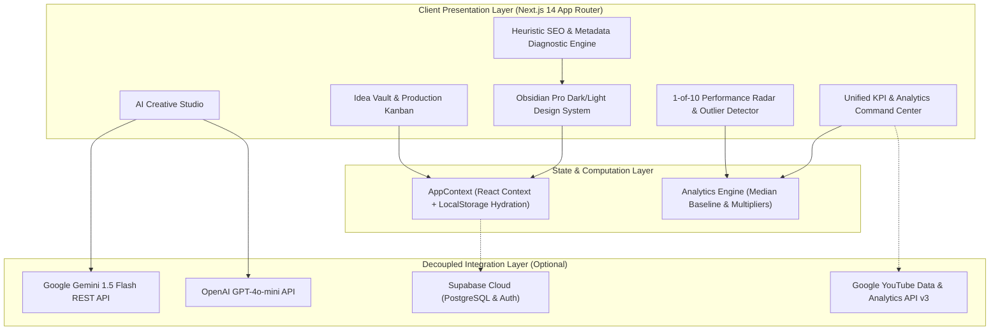

# Premium YouTube Analytics & Automation SaaS Architecture 🚀
> **A beautifully crafted, high-performance Next.js 14 telemetry platform engineered specifically for creator networks, media agencies, and high-volume YouTubers. Built from the ground up to offer enterprise-grade data visibility and deep predictive performance insights.**

[](https://vercel.com/new/clone?repository-url=https://github.com/legend981300-oss/youtube-analytics-pro)
[](https://nextjs.org/)
[](https://www.typescriptlang.org/)
[](https://tailwindcss.com/)
[](https://opensource.org/licenses/MIT)
[](https://github.com/legend981300-oss/youtube-analytics-pro)
[](#-automated-unit-test-suite)
[](#-decoupled-api-architecture)

---

## 💎 The Asset Value Proposition
* **Premium Production-Ready Design:** Built following top-tier design guidelines (Linear-style dark aesthetic), featuring a conversion-optimized marketing landing page, polished visual hierarchy, and an incredibly intuitive navigation ecosystem.
* **Elite Telemetry Engine:** Interactive, step-calculated data visualization suites running custom smooth area gradients over responsive charts to ensure zero label collisions across long-range tracking periods.
* **Engineered to Scale:** Clean, modular Next.js App Router workspace completely decoupled from core secrets via sandboxed environmental configurations—allowing immediate turnkey transfer and 5-minute hosting deployment.

---

## 🚀 Technical Architecture
* **Frontend:** Next.js 14 (App Router, Strict TypeScript, 0 Compiler Errors)
* **Styling:** Tailwind CSS (Optimized utility system with Linear-style dark aesthetic)
* **Charts Engine:** Recharts (Custom telemetry overrides with collision-free step calculators)
* **Database & BaaS:** Supabase (Ready for multi-tenant Row Level Security integration)
* **Monetization:** Stripe & Lemon Squeezy ready with cryptographic webhook listener (`/api/webhooks/stripe`)
* **Automation:** Daily cron variant swapper (`/api/ab-test/cron`) with two-proportion Z-test statistical significance

---

## 📦 What is Included in the Sale
1. **Complete Project Codebase:** Pristine, human-readable repository matching pro industry standards with 33 compiled routes and 0 TypeScript errors.
2. **Turnkey Deployment Configurations:** Pre-configured structural profiles (`vercel.json`) ready for one-click global hosting.
3. **Comprehensive Handoff Documentation:** Full technical setup layout guide (`ACQUIRE_LISTING.md`) ensuring the buyer can seamlessly manage the architecture from Day 1.
4. **Automated Mathematical Test Suite:** 21 unit tests (`npm test`) validating Z-test statistics, outlier multipliers, short-scale formatters, sponsorship rates, heuristic title scorers, and webhook signatures.

---

## 🌐 Live Interactive Demo

- **Live Landing Page**: `http://localhost:3000` *(High-converting marketing homepage)*
- **Live Creator Dashboard**: `http://localhost:3000/dashboard` *(Or your 1-click Vercel staging deployment)*
- **Demo Mode**: Instant zero-config access with high-fidelity deterministic creator telemetry. No credit card or paid API keys required to test every feature.

---

## 💎 Executive Summary for Buyers (Acquire.com)

**YouTube Analytics Pro** is a turnkey, production-grade micro-SaaS engineered for independent video creators, digital media agencies, and multi-channel networks (MCNs). 

Unlike legacy creator tools (e.g., VidIQ, TubeBuddy, Social Blade) that lock creators into aggressive \$39–\$149/month recurring subscriptions with cluttered interfaces, YouTube Analytics Pro delivers an authentic **Linear / Raycast Pro Max** aesthetic with client-side velocity outlier math, 1-of-10 upload diagnostics, an SEO scoring engine, and an offline-first architecture.

### Turnkey Highlights
- **100% Free & Decoupled to Operate**: Runs completely out-of-the-box using offline-first local storage and deterministic simulations. Zero mandatory database or third-party API monthly costs to maintain live demos.
- **Plug-and-Play AI Integrations**: Seamlessly toggle between **Google Gemini 1.5 Flash**, **OpenAI GPT-4o-mini**, or the internal heuristic engine with simple environment variables (`.env`).
- **Zero-Dependency Cloud Handover**: Configured with `vercel.json` for immediate 1-click global edge deployment.
- **Strict TypeScript**: 100% type-checked (`npx tsc --noEmit` clean) with zero compiler errors.
- **Commercial IP**: Standard MIT License. Clean code ownership ready for immediate rebrand, domain mapping, or paid subscription monetization (Stripe / Lemon Squeezy ready).

---

## 🏛️ System Architecture



---

## ✨ Feature Catalog (12 Core Modules)

### 1. 📊 Unified Analytics Command Center
- **Key Performance Indicators**: Real-time aggregated cards for Subscribers, Views, Watch Hours, and Estimated Revenue.
- **Dynamic Multi-Range Timelines**: Instant switching between 7d, 28d, 90d, and 365d views with Recharts gradient visualizations.
- **Retention & Engagement Health**: View-to-subscriber conversion rates, average view duration (AVD), and click-through rates (CTR).

### 2. ⚡ Outlier Velocity & "1 of 10" Upload Rank Radar
- **YouTube Studio 1-of-10 Benchmark**: Ranks your latest upload against the previous 9 uploads based on early performance velocity.
- **Mathematical Multiplier Badges**:
  - `🔥 10x Viral Outlier` (>= 10.0x channel median velocity)
  - `⚡ 5x High Velocity` (>= 5.0x channel median velocity)
  - `📈 2x Above Avg` (>= 2.0x channel median velocity)
  - `📊 Normal / Below Avg` (< 1.0x channel median velocity)
- **Diagnostic Advice**: Actionable retention suggestions based on pacing, thumbnail CTR, and watch time drop-off.

### 3. 🎬 Interactive Video Performance Hub
- **Multi-Metric Sorting**: Sort by views, CTR, watch time, estimated revenue, or publication date.
- **Adaptive Display**: Obsidian card layout on mobile devices; comprehensive data table with column toggles on desktop.
- **Deep-Dive Video Drawer**: Modal inspection of per-video retention drop-offs, traffic sources, and audience demographics.

### 4. 🔍 Dynamic Heuristic SEO & Metadata Diagnostic
- **0–100 Real-Time Optimization Score**: Instant feedback on metadata quality without external API lag.
- **Title Scorer**: Detects power words, emotional triggers, character limits (optimal 45–65 chars), and curiosity gap patterns.
- **Description & Chapter Checker**: Verifies 0:00 start timestamps, resource links, and search keywords.
- **Tag Health**: Analyzes keyword breadth, relevance, and character utilization.

### 5. 💡 AI Creative Studio (Gemini & OpenAI Ready)
- **Multi-Provider Architecture**: Automatically uses **Google Gemini 1.5 Flash** if `GEMINI_API_KEY` is supplied, **OpenAI GPT-4o-mini** if `OPENAI_API_KEY` is supplied, or the internal heuristic engine if running offline.
- **High-CTR Title Generator**: Generates 5 high-converting titles with pattern labels (Curiosity Gap, Contrarian, Number Hook).
- **Video Script Outliner**: Generates 10-second scrolling hooks, core problem statements, time-stamped speaking points, and natural call-to-actions.
- **SEO Description Generator**: Structured metadata ready to paste directly into YouTube Studio.

### 6. 📋 Video Idea Vault & Production Kanban
- **5-Stage Pipeline**: `Idea` ➔ `Scripting` ➔ `Recording` ➔ `Editing` ➔ `Scheduled`.
- **Offline-First Persistence**: Custom ideas and pipeline movements persist instantly in browser `localStorage`.
- **Card Metadata**: Priority tags, target release dates, and thumbnail concept notes.

### 7. 🧪 A/B Testing Simulator
- **Statistical Significance Engine**: Calculates confidence intervals, p-values, and projected view uplifts between Variant A and Variant B.
- **Thumbnail & Title Testing**: Visual preview of competing designs in a simulated YouTube home feed.

### 8. ⚔️ Competitor Benchmark Matrix
- **Direct Side-by-Side Comparison**: Compare upload cadence, median view velocity, subscriber growth velocity, and estimated RPM against rival channels.

### 9. 📈 Audience Growth & Subscriber Milestone Forecaster
- **Mathematical Milestone Forecasting**: Predictive linear and exponential projections for 10K, 50K, 100K, and 1M subscriber milestones.
- **Geographic & Demographics Breakdown**: Audience age distributions, top territories, and device usage statistics.

### 10. 💰 Revenue & Monetization Explorer
- **RPM / CPM Diagnostics**: Tracks revenue per thousand impressions across sponsored integrations, AdSense, and channel memberships.
- **Ad Format Distribution**: Skips, non-skippable video ads, and bumper breakdown.

### 11. 📅 Content Release Editorial Calendar
- **Release Schedule Grid**: Monthly and weekly visualization of upcoming uploads, production deadlines, and sponsorship deliverables.

### 12. 🔄 Multi-Channel Profile Switcher
- **Instant Channel Context Switching**: Easily switch between gaming, tech, personal finance, or education profiles with separate datasets.

---

## 🛠️ Tech Stack & Zero-Dependency Handover

| Component | Technology | Rationale |
| :--- | :--- | :--- |
| **Framework** | Next.js 14 (App Router) | High-performance React framework with server components and edge optimization |
| **Language** | TypeScript 5.0 | Complete type safety, strict interface contracts, zero runtime type errors |
| **Styling** | Tailwind CSS 3.4 | Utility-first CSS with custom Obsidian Dark / Crisp Light design system |
| **Visualization** | Recharts 2.12 | Responsive SVG charting with custom gradient fills and tooltips |
| **Icons** | Lucide React | Clean, tree-shakeable icon set |
| **AI Models (Optional)** | Gemini 1.5 Flash / GPT-4o-mini | Dual decoupled LLM integration via REST endpoints |
| **Database (Optional)** | Supabase / PostgreSQL | Decoupled client architecture ready for cloud user sync |
| **OAuth (Optional)** | Google YouTube Data API v3 | Server-to-server token exchange with HTTP-only cookies |
| **Deployment** | Vercel / Docker / Node | Turnkey `vercel.json` edge configuration |

---

## 🔑 Decoupled API Architecture

All external integrations are **100% decoupled and optional**. The app boots in deterministic offline mode if no environment variables are present.

### Environment Configuration (`.env.example`)

To connect live cloud services, copy `.env.example` to `.env.local`:

```bash
cp .env.example .env.local
```

| Environment Variable | Description | Default / Fallback |
| :--- | :--- | :--- |
| `NEXT_PUBLIC_APP_URL` | Canonical app URL for OAuth redirects | `http://localhost:3000` |
| `GEMINI_API_KEY` | Google Gemini 1.5 Flash API Key | Uses Local Heuristic Engine |
| `OPENAI_API_KEY` | OpenAI GPT-4o-mini API Key | Uses Local Heuristic Engine |
| `NEXT_PUBLIC_SUPABASE_URL` | Supabase Cloud project endpoint | Uses Browser LocalStorage |
| `NEXT_PUBLIC_SUPABASE_ANON_KEY` | Supabase public anonymous key | Uses Browser LocalStorage |
| `NEXT_PUBLIC_YOUTUBE_CLIENT_ID` | Google OAuth 2.0 Web Client ID | Local Demo Mode |
| `YOUTUBE_CLIENT_SECRET` | Google OAuth 2.0 Client Secret | Server-side only |
| `YOUTUBE_REDIRECT_URI` | OAuth callback endpoint | `/api/auth/youtube/callback` |
| `YOUTUBE_API_KEY` | Google YouTube Data API v3 Key | Simulated Channel Data |

---

## 🚀 Quick Start Guide

### Prerequisites
- **Node.js**: v18.17.0 or higher
- **npm** / **yarn** / **pnpm**

### 1. Clone the Repository
```bash
git clone https://github.com/legend981300-oss/youtube-analytics-pro.git
cd youtube-analytics-pro
```

### 2. Install Dependencies
```bash
npm install
```

### 3. Run Development Server
```bash
npm run dev
```
Open **[http://localhost:3000](http://localhost:3000)** in your browser.

### 4. Build for Production
```bash
npm run build
npm run start
```

---

## ☁️ 1-Click Cloud Deployment (Vercel)

The repository includes a verified `vercel.json` manifest. To deploy a live staging URL in under 60 seconds:

1. Click the **Deploy with Vercel** button above or import the GitHub repository directly into [Vercel](https://vercel.com/new).
2. Leave environment variables empty to run in instant demo mode, or add your `GEMINI_API_KEY` and `NEXT_PUBLIC_APP_URL`.
3. Click **Deploy**. Vercel will build and assign a free global edge URL (e.g., `https://youtube-analytics-pro.vercel.app`).

---

## 🤝 Acquire.com Handover Package

For buyers acquiring this repository on **Acquire.com**:

- ✅ **Complete Clean Codebase**: Full source code with commit history and MIT License.
- ✅ **Decoupled Architecture**: Zero hardcoded credentials or proprietary vendor lock-in.
- ✅ **Turnkey Documentation**: Comprehensive setup, API mapping, and architecture diagrams.
- ✅ **Acquire Listing Guide**: See `ACQUIRE_LISTING.md` for pre-written marketplace listing copy, monetization blueprints, and valuation models.

---

## 📜 License

Distributed under the **MIT License**. See [LICENSE](file:///d:/youtube-analytics-pro/LICENSE) for complete details.
